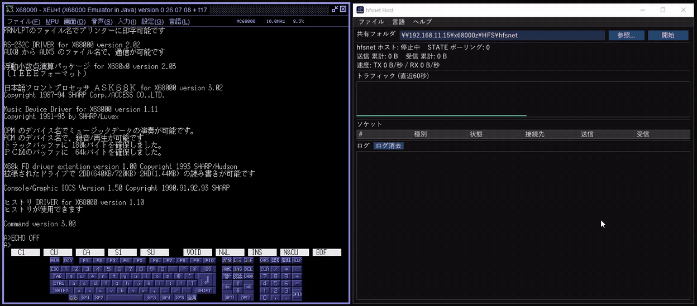
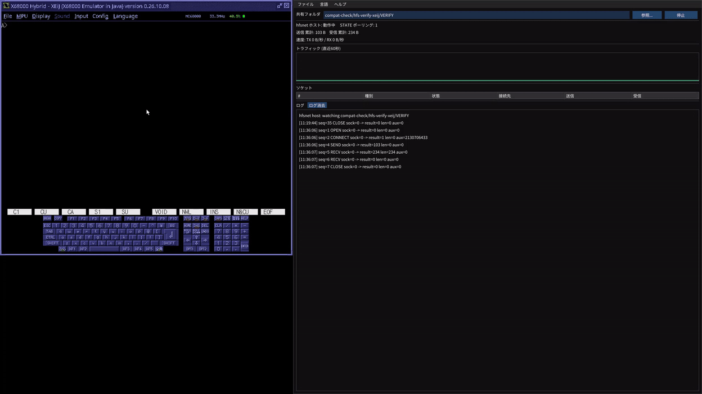
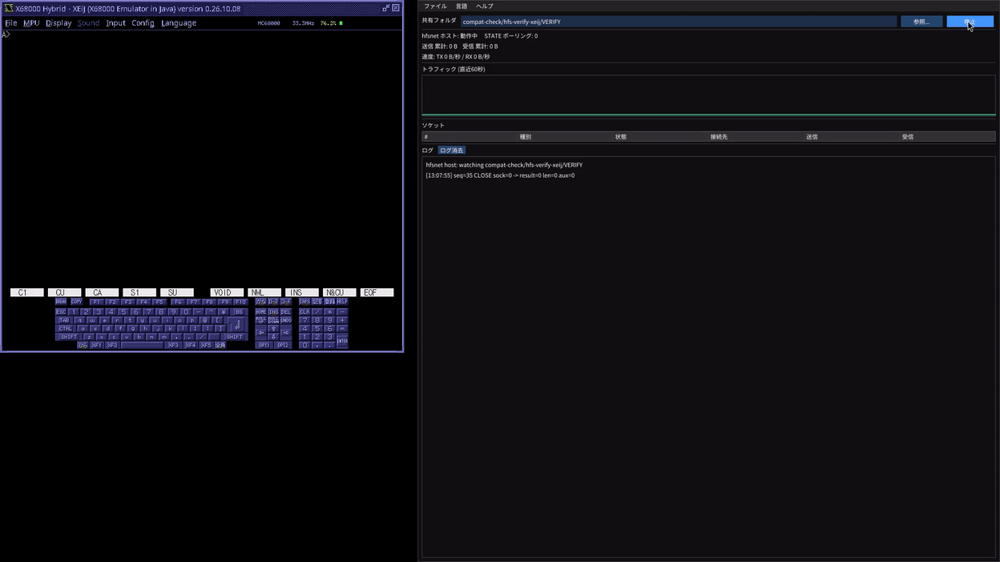
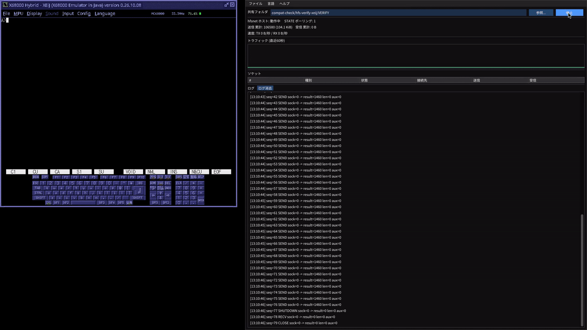
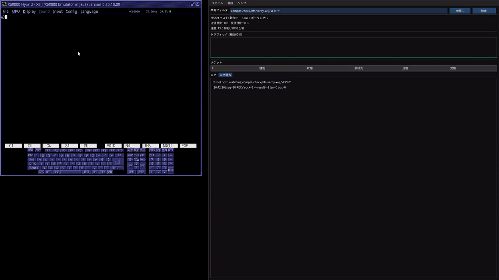
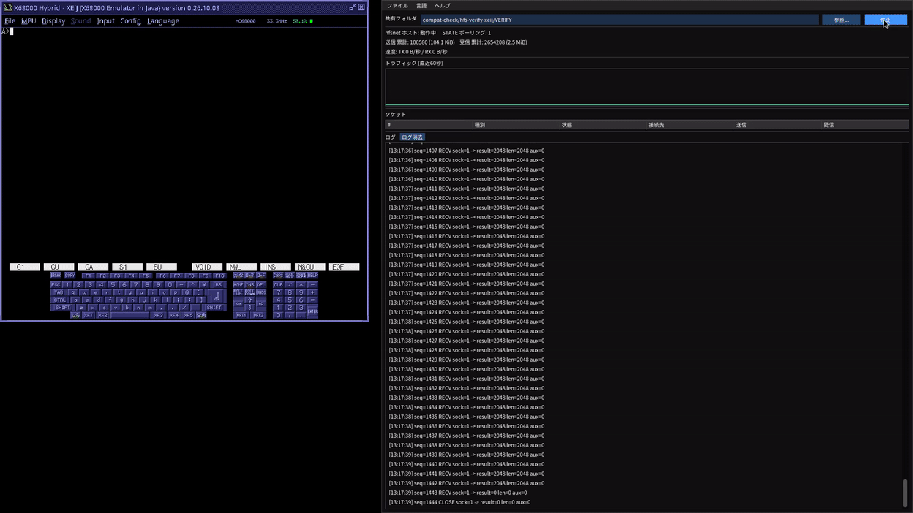
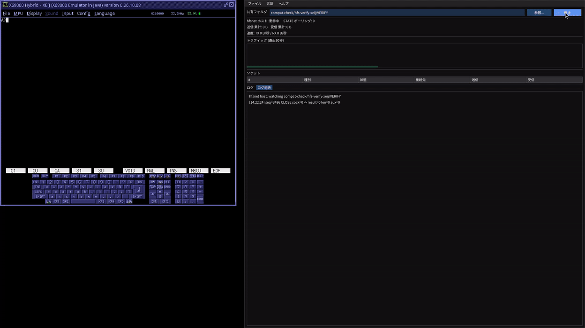

[English](README.en.md) | [日本語](README.md)

#  hfsnet - an inetd.x-compatible driver over HFS

inetd.x-compatible TCP/IP driver for Human68k over HFS (Host File Systems)

## What is this?

hfsnet is a driver that brings TCP/IP networking to the X68000 /
Human68k. Using only the host file system feature (such as XEiJ's **HFS** or WebX68k's **HostFS**),
it provides a Keisoku Giken **inetd.x-compatible
API** (the TCP/IP driver calling convention, the so-called TI entry).
For XEiJ and WebX68k, there is currently no other way to connect to
a network without additional hardware.

Existing communication applications that use the inetd.x-compatible
API then just work:

- Fetch web pages with `httpclient.x` or WebXpressionPlus
- Transfer files with `ftp.x`, log in remotely with `telnet.x`
- Set the clock with `sntp.x`, check reachability with `ping.x`,
  measure throughput with `iperf.x`
- Send and receive over TCP / UDP with `nc.x` (netcat-x68k)

The mechanism is simple: a resident driver on the Human68k side, `hfsnet.x`,
translates TI calls from applications into file exchanges inside the
shared folder, and an application on the host operates the real
sockets. No emulator-specific features are used — only ordinary file
reads and writes. The same mechanism therefore also works on real
hardware, as long as there is a folder both sides can read and write,
such as XM6 TypeG's **Windrv** or the X68000Z's file sharing feature.

## In action

All of these were recorded with XEiJ and the GUI host (click an image to
view it at full size).

| ping.x running (left: guest, right: host side; pinging www.google.com and receiving replies) |
| :--- |
|  |

| httpclient.x running (left: guest, right: the GUI host) |
| :--- |
|  |

| iperf.x in client mode (left: guest, right: host side) |
| :--- |
|  |

| iperf.x in server mode (left: guest, right: host side; played at 2x speed) |
| :--- |
|  |

| sntp.x running (left: guest, right: host side; fetching the time from an SNTP server over UDP) |
| :--- |
|  |

| telnet.x running (left: guest, right: host side; the TCPPACK telnet client connecting to a test server, exchanging echoes, and disconnecting) |
| :--- |
|  |

| WebXpressionPlus running (left: guest, right: host side; a web browser fetching and displaying a test page, then following a link to a second page) |
| :--- |
|  |

| nc.x running (left: guest, right: host side; netcat-x68k connecting to an echo server, exchanging data, then exiting back to the prompt when the peer disconnects) |
| :--- |
|  |

## Getting started

These steps are for XEiJ or WebX68k first. You need:

- A PC running XEiJ or WebX68k (Windows / macOS / Linux)
- A shared folder that both the guest and the host can read and write
  (writes must reach the real file when the file is closed)

Steps:

1. Download the ZIP for your OS (Windows / Linux / macOS) from
   [Releases](https://github.com/renatus-novus-x/hfsnet/releases)
   and extract it
2. Start the host-side application (either the GUI host or the Python host — only one of them)
   - GUI host (recommended): launch `hfsnet-host`, select the shared
     folder the emulator uses (the HFS folder for XEiJ, the HostFS
     folder for WebX68k), and press Start
   - Python host: `python3 hfsnethost.py <path to the shared folder>`
     (Python 3, standard library only. It does not handle ICMP,
     so use the GUI host if you want ping.x)
3. Load the driver on the guest (give the folder's guest-side path):
   `hfsnet.x C:\HFSNET`
4. Applications that use an inetd.x-compatible API (such as
   httpclient.x, which uses elf2x68k's libsocket) can then
   communicate as-is

The driver can also be removed without rebooting. Give `/r` instead
of the folder (`-r` works too):

`hfsnet.x /r`

- On success it prints `hfsnet: removed.`
- If the driver is not resident it prints `hfsnet: not installed.`
  (this is not an error)
- If any socket is still in use it refuses, printing
  `hfsnet: cannot remove: N socket(s) in use.`
- Do not remove the driver while a network application is running
  (an application may have cached the driver's entry point)

### Verified environments

On each of XEiJ (HFS), XM6 TypeG (Windrv), and WebX68k (HostFS), the
following have been verified: HTTP fetching with httpclient.x, iperf
in client and server modes, SNTP time fetching with sntp.x (UDP),
full telnet.x and telnet.x beta3 sessions, nc.x over TCP (client and
listening) and UDP, and WebXpressionPlus fetching and displaying
plain HTTP pages.

On real hardware, both an X68000Z and an X68000Z XVI "X EMULATER"
combined with x68kzremotedrv (a remote drive service using a
Raspberry Pi Pico W), and the X68000Z XVI's built-in Windows file
sharing feature, have been verified with HTTP fetching by
httpclient.x (including name resolution) and SNTP time fetching by
sntp.x. A throughput report for iperf measured on real hardware
(X68000Z XVI) is available in
[compat-check/IPERF-REPORT.en.md](compat-check/IPERF-REPORT.en.md).

## Known limitations

- Latency: every TI call becomes a file round trip, so applications that
  repeat small reads and writes will be slow. RECV waits up to 300 ms on
  the host side before answering "no data", which keeps useless round
  trips down
- Resident memory: the driver keeps its whole image resident
- Loading the driver twice is detected via the existing TCP/IP driver
  search and stopped
- ftp.x (TCPPACK) can connect, log in, list directories, and quit, but
  a get whose destination is a filesystem-driver-type drive such as
  HFS fails: before saving, ftp.x issues _FATCHK (a DOS call that
  walks the FAT cluster chain), which cannot pass on this kind of
  drive. On XEiJ, XM6 TypeG, and WebX68k, choosing a real drive
  such as a floppy or a hard disk as the destination lets the get
  succeed
- The displays of ifconfig.x / netstat.x / inetdconf.x / arp.x
  (TCPPACK) work. Settings made on the guest side (addresses, the
  default router, DNS servers, and so on) are kept for display
  purposes only: the actual traffic is handled by the host's stack,
  so they do not affect communication itself

## How it works / technical details

- Human68k side: a resident driver, `hfsnet.x` (built with elf2x68k). It
  translates TI calls from applications into request/response file
  exchanges inside the shared folder
- Host side: the GUI application `hfsnet-host`, or the console app
  `hfsnethost.py` (Python 3, standard library only). It watches the
  request file, operates real TCP sockets, and writes the results
  into the response file

Receive notification is done by polling — the driver periodically
re-opens the response file — rather than by interrupts (blocking
calls wait in a loop inside the driver).

The file protocol specification, the list of TI functions the driver
implements, and build instructions are in the
[technical details (docs/TECHNICAL.en.md)](docs/TECHNICAL.en.md).

## Licenses

The licenses of the libraries and the font used by the GUI host
are collected in THIRD-PARTY-NOTICES.txt and the licenses/
folder of the distribution.
