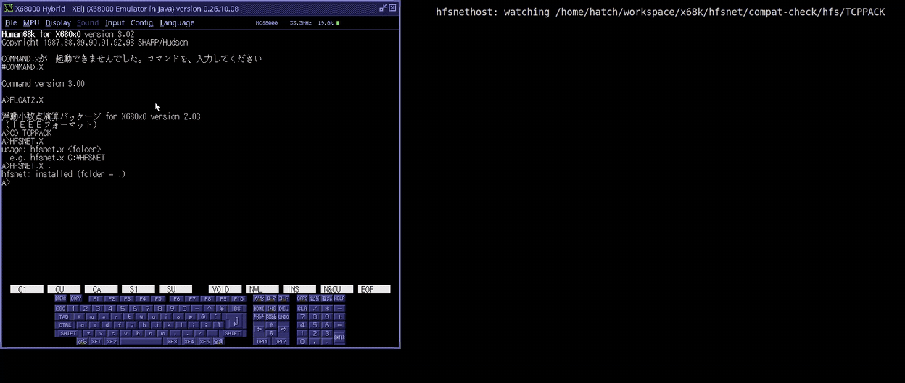
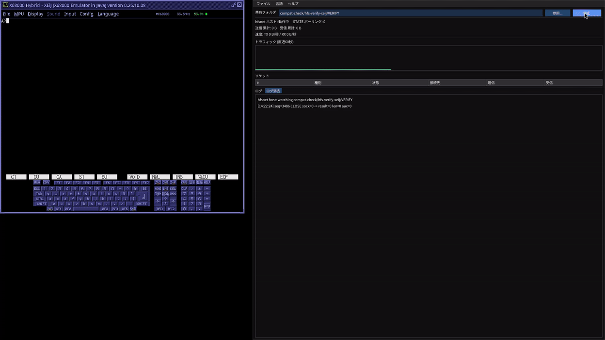
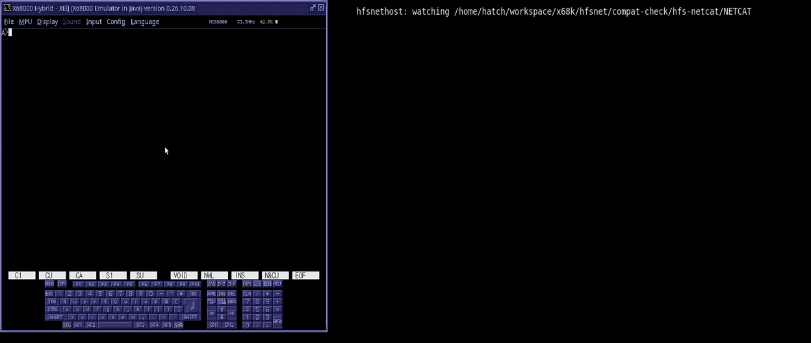

[English](README.en.md) | [日本語](README.md)

# hfsnet — 共有フォルダ経由の inetd.x 互換ドライバ

Human68k 向け inetd.x 互換 TCP/IP ドライバ（HostFS / HFS 共有フォルダ経由）

 

## これは何か

hfsnet は、X68000 / Human68k に TCP/IP 通信を持ち込むためのドライバです。
エミュレータの共有フォルダ機能（XEiJ の **HFS**、WebX68k の **HostFS**）
だけを使って、
計測技研 **inetd.x 互換 API**（TCP/IP ドライバの呼び出し規約、いわゆる
TI エントリ）を提供します。XEiJ と WebX68k に関しては、追加
ハードウェアなしにネットにつなぐ手段は、現在のところ他にありません。

これで、inetd.x 互換 API を使う既存の通信アプリがそのまま動きます:

- `httpclient.x` や WebXpressionPlus で Web ページの取得
- `ftp.x` でファイル転送、`telnet.x` でリモートログイン
- `sntp.x` で時刻合わせ、`ping.x` で到達確認、`iperf.x` で速度計測
- `nc.x`（netcat-x68k）で TCP / UDP の送受信

仕組みは単純で、ゲスト側の常駐ドライバ `hfsnet.x` がアプリからの
TI 呼び出しを共有フォルダ内のファイルのやり取りに翻訳し、ホスト側の
アプリが実際のソケットを操作します。エミュレータ固有の機能は一切
使わず、使うのは通常のファイル読み書きだけです。そのため実機でも、
XM6 TypeG の **Windrv** や X68000Z のファイル共有機能など、双方向に
読み書きできる共有フォルダがあれば同じ仕組みで動きます。

実験実装です。

## 動作の様子

いずれも XEiJ と GUI 版ホストでの実行です。

httpclient.x の実行（左: ゲスト、右: ホスト側 GUI 版ホスト）:

iperf.x クライアントモード（左: ゲスト、右: ホスト側）:

iperf.x サーバーモード（左: ゲスト、右: ホスト側。2倍速再生）:

sntp.x の実行（左: ゲスト、右: ホスト側。UDP で SNTP サーバーから時刻を取得）:

telnet.x の実行（左: ゲスト、右: ホスト側。TCPPACK の telnet クライアントで
テストサーバーへ接続し、エコーのやり取りをして切断）:

WebXpressionPlus の実行（左: ゲスト、右: ホスト側。Web ブラウザで
テストページを取得・表示し、リンク先のページへ遷移）:

nc.x の実行（左: ゲスト、右: ホスト側。netcat-x68k でエコーサーバーへ
接続して送受信し、相手の切断で終了してプロンプトへ復帰）:

## 導入方法

まず XEiJ または WebX68k で使う手順です。必要なもの:

- XEiJ または WebX68k が動く PC（Windows / macOS / Linux）
- ゲストとホストで双方向に読み書きできる共有フォルダ
  （書き込みは閉じた時点で実ファイルへ反映されること）

手順:

1. [Releases](https://github.com/renatus-novus-x/hfsnet/releases) から、
   使う OS の ZIP（Windows / Linux / macOS）をダウンロードして展開する
2. ホスト側アプリを起動する
   - GUI 版（推奨）: `hfsnet-host` を起動し、エミュレータが使っている
     共有フォルダ（XEiJ の HFS フォルダ、WebX68k の HostFS フォルダ）を
     選んで「開始」を押す
   - Python 版: `python3 hfsnethost.py <共有フォルダのパス>`
     （Python 3、標準ライブラリのみ。ICMP は扱わないので、
     ping.x を使う場合は GUI 版を使ってください）
3. ゲスト側でドライバを常駐させる（フォルダのゲスト側パスを指定）:
   `hfsnet.x C:\HFSNET`
4. あとは inetd.x 互換 API を使うアプリ（elf2x68k の libsocket を使う
   httpclient.x など）がそのまま通信できます

ドライバは再起動しなくても常駐解除できます。フォルダの代わりに
`/r` を指定します（`-r` でも同じです）:

`hfsnet.x /r`

- 解除できると `hfsnet: removed.` と表示されます
- 常駐していない場合は `hfsnet: not installed.` と表示されます（異常ではありません）
- 使用中のソケットがある場合は
  `hfsnet: cannot remove: N socket(s) in use.` と表示して解除を拒否します
- ネットワークアプリを実行している最中は解除しないでください
  （アプリ側がドライバの入口を覚えている場合があるため）

### 動作確認済みの環境

XEiJ（HFS）、XM6 TypeG（Windrv）、WebX68k（HostFS）の3環境で、
httpclient.x の HTTP 取得、iperf のクライアント／サーバー動作、
sntp.x の SNTP 時刻取得（UDP）、telnet.x と telnet.x beta3 の
セッション完走、nc.x の TCP（クライアント／待ち受け）と UDP の
送受信、WebXpressionPlus の平文 HTTP のページ取得・表示を
確認しています。

実機でも、X68000Z および X68000Z XVI "X EMULATER" に
x68kzremotedrv（Raspberry Pi Pico W によるリモートドライブ）を
組み合わせた構成と、X68000Z XVI の純正の Windows とのファイル共有
機能で、httpclient.x の HTTP 取得（名前解決を含む）と sntp.x の
SNTP 時刻取得を確認しています。実機（X68000Z XVI）での iperf
スループット実測レポートは
[compat-check/IPERF-REPORT.md](compat-check/IPERF-REPORT.md) にあります。

## 既知の限界

- 遅延: 1回の TI 呼び出しがファイル往復になるため、細かい読み書きを
  繰り返すアプリでは遅くなります。RECV はホスト側で最大 300ms 待ってから
  「データ無し」を返すので、無駄な往復は抑えています
- 常駐メモリ: ドライバはイメージ全体を常駐させます
- ドライバの多重常駐は、既存の TCP/IP ドライバ検索で検出して止めます
- ftp.x（TCPPACK）は接続・ログイン・ディレクトリ表示・終了は使えますが、
  get の保存先が HFS のようなファイルシステムドライバ型のドライブだと
  失敗します。ftp.x が保存の前に出す _FATCHK（FAT のクラスタ連鎖を
  たどるための DOS 呼び出し）が、この種のドライブでは通らないためです。
  XEiJ、XM6 TypeG、WebX68k では、保存先をフロッピーや HDD のような
  実ドライブにすると取得できます

## 仕組みと技術詳細

- ゲスト側: 常駐ドライバ `hfsnet.x`（elf2x68k 製）。アプリからの TI 呼び出しを
  共有フォルダ内の要求ファイル／応答ファイルのやり取りに翻訳します
- ホスト側: GUI 版アプリ `hfsnet-host`、またはコンソールアプリ
  `hfsnethost.py`（Python 3、標準ライブラリのみ）。要求ファイルを見張り、
  実際のソケットを操作して応答ファイルに結果を書きます

受信の通知は割り込みではなく、ドライバが応答ファイルを定期的に開き直す
ポーリングで実現しています（ブロッキング呼び出しはドライバ内部のループで待ちます）。

ファイルプロトコルの仕様、ドライバが実装する TI 関数の一覧、ビルド方法は
[技術詳細（docs/TECHNICAL.md）](docs/TECHNICAL.md) にあります。

## ライセンス

GUI 版ホストが使うライブラリとフォントのライセンスは、
配布物の THIRD-PARTY-NOTICES.txt と licenses/ フォルダに
まとめています。
