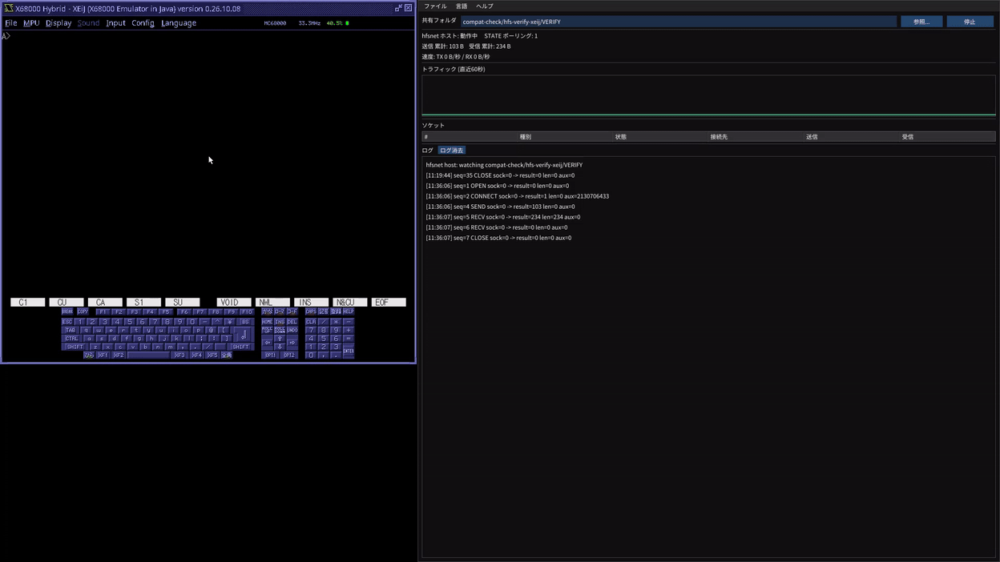
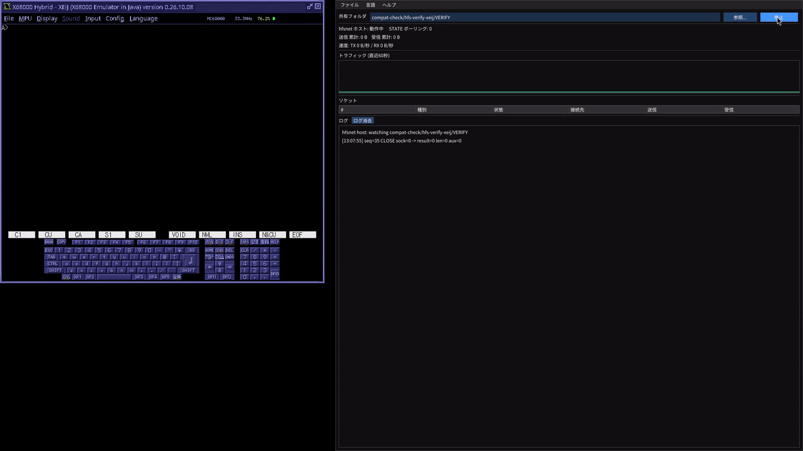
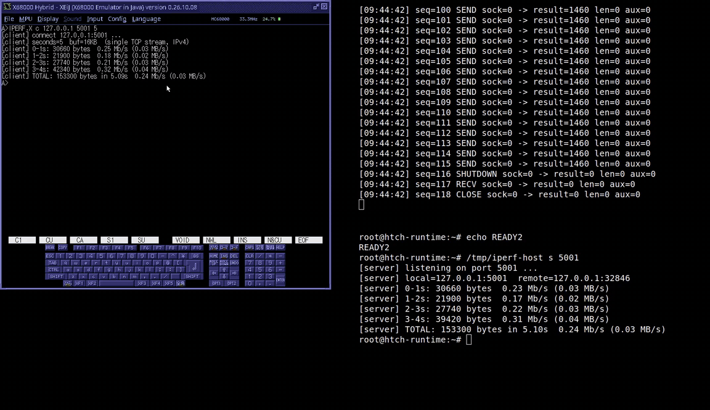

[English](README.en.md) | [日本語](README.md)

# hfsnet — 共有フォルダ経由の inetd.x 互換ドライバ

ホスト側フォルダをゲストから読み書きできる仕組み（XEiJ の **HFS** など）
だけを使って、Human68k に計測技研 **inetd.x 互換 API**
（TCP/IP ドライバの呼び出し規約、いわゆる TI エントリ）を提供する実験実装です。

エミュレータ固有の機能は一切使いません。使うのは通常のファイル読み書きだけです。

- ゲスト側: 常駐ドライバ `hfsnet.x`（elf2x68k 製）。アプリからの TI 呼び出しを
  共有フォルダ内の要求ファイル／応答ファイルのやり取りに翻訳します
- ホスト側: コンソールアプリ `hfsnethost.py`（Python 3、標準ライブラリのみ）。
  要求ファイルを見張り、実際の TCP ソケットを操作して応答ファイルに結果を書きます

受信の通知は割り込みではなく、ドライバが応答ファイルを定期的に開き直す
ポーリングで実現しています（ブロッキング呼び出しはドライバ内部のループで待ちます）。

## 動作の様子

いずれも XEiJ 上での実行です。

httpclient.x の実行（左: ゲスト、右: ホスト側 hfsnethost.py のログ）:



iperf.x クライアントモード（左: ゲスト、右: ホスト側）:



iperf.x サーバーモード（左: ゲスト、右: ホスト側。2倍速再生）:



## 動作条件

- ゲストとホストで**双方向に読み書きできる共有フォルダ**があること
  （書き込みは閉じた時点で実ファイルへ反映されること）
- ホスト側で `hfsnethost.py` が常駐していること
- ゲスト側アプリは elf2x68k の libsocket など、inetd.x 互換 API を使うもの

動作確認済みの組み合わせ: XEiJ の HFS 経由で、httpclient.x の HTTP 取得と
iperf のクライアント／サーバー動作を確認しています。

## ダウンロード

ビルド済みパッケージ（`hfsnet.x` と `hfsnethost.py` をまとめた zip）は
[Releases](https://github.com/renatus-novus-x/hfsnet/releases) から
ダウンロードできます。

## ファイルプロトコル

共有フォルダに置くファイルは2つだけです。どちらもバイナリ形式、
多バイト値はビッグエンディアン（ネットワークバイトオーダ）です。

- `HFSREQ.BIN` — ゲスト → ホスト の要求（ゲストが書く）
- `HFSRES.BIN` — ホスト → ゲスト の応答（ホストが書く。一時名で書いてから
  リネームして差し替えるので、ゲストが書きかけを読むことはありません）

### 要求（HFSREQ.BIN、ヘッダ 20 バイト＋ペイロード）

| オフセット | サイズ | 内容 |
| --- | --- | --- |
| 0 | 2 | マジック `'H' 'N'` |
| 2 | 1 | 操作コード（下表） |
| 3 | 1 | ソケット番号（ゲスト側のスロット 0〜31） |
| 4 | 4 | 通し番号（ゲストが要求ごとに増やす。応答の照合に使う） |
| 8 | 2 | ポート番号（CONNECT / BIND で使用。UDP の SEND では宛先ポート） |
| 10 | 2 | 補助引数（OPEN のソケット種別（0 = SOCK_STREAM、1 = SOCK_DGRAM）、LISTEN の backlog、ACCEPT の受け入れ先スロット、SHUTDOWN の how） |
| 12 | 4 | IPv4 アドレス（CONNECT / BIND で使用。UDP の SEND では宛先アドレス） |
| 16 | 4 | ペイロード長（RECV では受け取り上限） |
| 20 | 可変 | ペイロード（SEND のデータ、RESOLVE のホスト名など） |

### 応答（HFSRES.BIN、ヘッダ 24 バイト＋ペイロード）

| オフセット | サイズ | 内容 |
| --- | --- | --- |
| 0 | 2 | マジック `'H' 'N'` |
| 2 | 1 | 操作コード（要求の写し） |
| 3 | 1 | ソケット番号（要求の写し） |
| 4 | 4 | 通し番号（要求の写し） |
| 8 | 4 | 結果（操作ごとに意味が違う。下表） |
| 12 | 2 | ポート番号（ACCEPT で相手のポート、UDP の RECV では送信元ポート） |
| 14 | 2 | 予約（0） |
| 16 | 4 | ペイロード長（STATE では受信可能バイト数） |
| 20 | 4 | 補助値（STATE では状態コード、RESOLVE では IPv4 アドレス、ACCEPT では相手の IPv4 アドレス、UDP の RECV では送信元 IPv4 アドレス） |
| 24 | 可変 | ペイロード（RECV のデータ） |

### 操作コードと結果の意味

| コード | 名前 | 結果（result）の意味 |
| --- | --- | --- |
| 1 | OPEN | 0 = 成功、-1 = 失敗 |
| 2 | CLOSE | 0 = 成功 |
| 3 | CONNECT | 0 = 接続完了、1 = 接続中、-1 = 失敗 |
| 4 | SEND | 送信できたバイト数、-2 = 今は送れない、-1 = 失敗 |
| 5 | RECV | 受信したバイト数、0 = 相手が閉じた（EOF）、-2 = まだデータが無い、-1 = 失敗 |
| 6 | STATE | 状態コード（下表）。len = 受信可能バイト数、aux = 送信可能バイト数（近似） |
| 7 | RESOLVE | 0 = 成功（aux に IPv4 アドレス）、-1 = 失敗 |
| 8 | BIND | 0 = 成功、-1 = 失敗 |
| 9 | LISTEN | 0 = 成功、-1 = 失敗 |
| 10 | ACCEPT | 0 = 成功、-2 = まだ接続が来ていない、-1 = 失敗 |
| 11 | SHUTDOWN | 0 = 成功、-1 = 失敗。how（補助引数）: 0 = 受信側、1 = 送信側、2 = 両方 |

状態コード: 0 CLOSED / 1 LISTEN / 2 SYN_SENT / 3 SYN_RECEIVED /
4 ESTABLISHED / 5 CLOSE_WAIT / 6 FIN_WAIT / 7 TIME_WAIT / 8 CLOSING

### 同期の約束

- 同時に処理中の要求は1つだけです（Human68k のアプリは基本的に
  1つの流れでドライバを呼ぶため、これで足ります）
- ゲストは要求を書いて閉じてから、応答の通し番号が自分のものと一致するまで
  応答ファイルを開き直し続けます
- ホストは、通し番号が前回処理したものと違う要求だけを処理します。
  書きかけの要求（ヘッダの長さと実ファイル長が合わないもの）は読み直します

## ゲスト側ドライバが実装する TI 関数

番号は計測技研 tcpipdrv.h の関数番号表（`_TI_` の並び順）に従います。

実装済み: get_version / socket / bind / listen / accept / connect /
read_s / write_s / recvfrom / sendto / close_s / shutdown / socklen /
getsockname / getpeername / sockstate / sock_top / gethostbyname

それ以外は -1 を返します。制限事項:

- 対応するソケット種別は TCP（SOCK_STREAM）と UDP（SOCK_DGRAM）です。
  RAW は socket() が -1 を返します
- ICMP は非対応です。ping.x は ICMP（インターネット制御メッセージ・
  プロトコル）を使うため生ソケット（SOCK_RAW）で開くのですが、本ドライバは
  TCP / UDP のみ対応で、生ソケットの socket() には -1 を返します。
  TCP と UDP のみの対応でも、実用上はそれなりに使えます
- sendto / recvfrom のアドレス指定は UDP では有効です
  （TCP では接続済みソケットとして扱います）
- MSG_PEEK などの flags は無視します
- getsockname は bind したアドレス（未 bind なら 0.0.0.0:0）を返します

ドライバの置き場所（メモリ常駐の入口）は、実在の inetd.x 互換ドライバ
（yunkya2 氏の joynetd など）と同じ作法です。プログラムイメージの先頭に
`"TCP/IP"` の署名を置き、その直後（先頭から8バイト目）が入口で、
関数番号を D0、引数配列へのポインタを A0 に入れて呼ばれ、結果が D0 に返ります。
ソケットの状態構造体（usock 配列）は sock_top で公開し、libsocket が
ノンブロッキング指定のフラグを直接読み書きする約束にも合わせています。

## ビルド

ゲスト側（elf2x68k を使用）:

```sh
cd guest
export PATH=<elf2x68k の bin ディレクトリ>:$PATH
make        # hfsnet.x ができる
```

ホスト側はビルド不要です。

## 使い方

1. 共有用フォルダを1つ作り（例: PC 側の `hfsnet-share`）、
   エミュレータの HFS などでゲストのドライブとして接続する
   （書き込み許可で接続すること）
2. ホスト側で相方を起動する:
   `python3 host/hfsnethost.py <共有フォルダのパス>`
3. ゲスト側でドライバを常駐させる（フォルダのゲスト側パスを指定）:
   `hfsnet.x C:\HFSNET`
4. あとは libsocket を使うアプリ（elf2x68k サンプルの httpclient.x など）が
   そのまま通信できます

## 既知の限界

- 遅延: 1回の TI 呼び出しがファイル往復になるため、細かい読み書きを
  繰り返すアプリでは遅くなります。RECV はホスト側で最大 300ms 待ってから
  「データ無し」を返すので、無駄な往復は抑えています
- 常駐メモリ: ドライバはイメージ全体を常駐させます
- ドライバの多重常駐は、既存の TCP/IP ドライバ検索で検出して止めます
