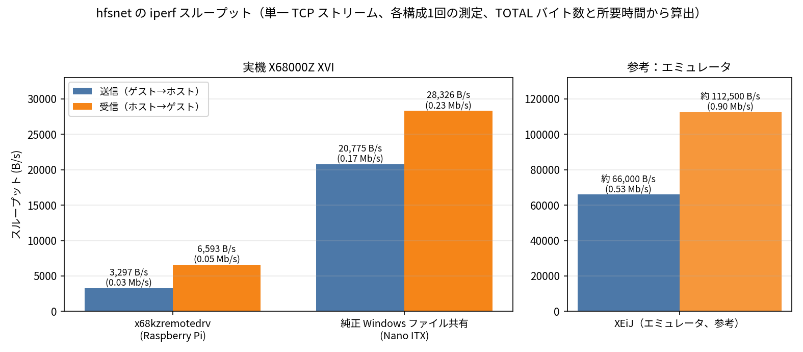
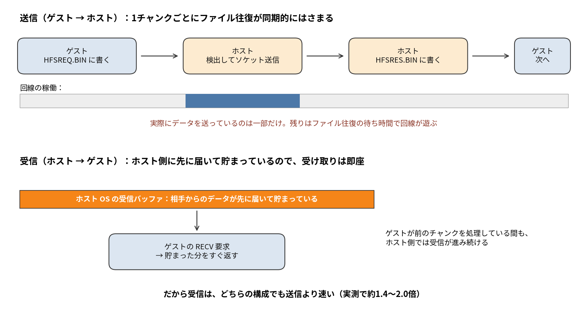

# hfsnet iperf Throughput Measurements on the X68000Z XVI

[日本語](IPERF-REPORT.md)

- Date: 2026-11-19
- Setup: real X68000Z XVI "X EMULATER", hfsnet v0.4.0
- Two sharing routes were measured: x68kzremotedrv (by yunkya2) running on a Raspberry Pi, and the X68000Z XVI's built-in "Windows file sharing" feature (the peer is the internal Nano ITX Windows PC)

## Conditions

- iperf, single TCP stream, 64KB buffer, IPv4
- "Client" means the guest ran as the iperf client (guest sends); "server" means the guest ran as the iperf server (guest receives)
- Rates are computed from the TOTAL byte counts and elapsed times in the iperf output (the Mb/s figures iperf displays are shown for reference)
- Each configuration was measured once (no variance estimate)

## Results

| Configuration | Direction | Transferred (TOTAL) | Time | Rate |
|---|---|---:|---:|---:|
| x68kzremotedrv | Send (guest → host) | 36,500 B | 11.07 s | 3,297 B/s (0.03 Mb/s) |
| x68kzremotedrv | Receive (host → guest) | 868,352 B | 131.70 s | 6,593 B/s (0.05 Mb/s) |
| Built-in Windows file sharing | Send (guest → host) | 211,700 B | 10.19 s | 20,775 B/s (0.17 Mb/s) |
| Built-in Windows file sharing | Receive (host → guest) | 1,114,112 B | 39.33 s | 28,326 B/s (0.23 Mb/s) |

Reference (XEiJ emulator, measured 2026-11-17): send approx. 66,000 B/s (0.53 Mb/s), receive approx. 112,500 B/s (0.90 Mb/s).

## Observations

1. **The built-in Windows file sharing is faster in both directions**: about 6.3x on send and about 4.3x on receive.
2. **Receiving beats sending in both configurations**: about 1.36x with the built-in sharing and about 2.0x with x68kzremotedrv. The emulator (XEiJ) shows the same direction of asymmetry (about 1.7x), which points to hfsnet's structure as the cause (see below).
3. **With x68kzremotedrv, the per-second amounts are almost perfectly constant**: exactly 4,380 B/s (= 1,460 x 3) per second on send, and almost exactly 8,192 B/s per second on receive. This looks like a deterministic ceiling set by the polling cycle rather than jitter. With the built-in sharing, the per-second amounts vary between 14k and 34k B/s, so its bottleneck lies elsewhere.
4. **Real hardware is slower than the emulator**: even the fastest result (built-in sharing, receive, 0.23 Mb/s) is about a quarter of XEiJ's receive rate (0.90 Mb/s).
5. In practical terms, transferring 1 MB takes about 37 seconds at the built-in sharing's receive rate, and about 5 minutes at x68kzremotedrv's send rate.

## Why receiving is faster than sending

hfsnet passes API-level requests between the guest and the host through two files in a shared folder (HFSREQ.BIN and HFSRES.BIN).

- **When sending**, each chunk (up to 2,048 bytes) the guest writes must be picked up by the host, sent over the socket, and answered through the response file before the guest can move on. The file round trip is synchronous, so the wire sits idle during the waits.
- **When receiving**, incoming data arrives ahead of time and accumulates in the host OS's receive buffer. The host can answer the guest's RECV requests immediately from what has already arrived, and reception keeps progressing on the host side while the guest processes the previous chunk.

## Caveats

- Each configuration was measured once (n=1); reproducibility across repeated runs has not been checked.
- On the receive (server) side, the elapsed time is determined by the peer's connection duration, so configurations are compared in B/s rather than by raw byte totals.
- In the x68kzremotedrv send run, the per-second lines of the iperf output did not add up to the TOTAL, so the TOTAL was taken as authoritative.

## Discussion: comparing the two sharing routes

In these measurements, the built-in "Windows file sharing" was faster in both directions. The two routes, however, differ in many respects — not only the transmission medium, but also the processing and protocols in between — so the difference in speed cannot be attributed to any single factor. What follows is an organization of what can be considered from objectively verifiable information.

The x68kzremotedrv route uses the X68000Z's Pseudo SCSI feature: a USB-connected Raspberry Pi Pico W makes a Windows PC's shared folder, reached over a wireless LAN, appear as if it were a disk image on a USB memory stick (per the x68kzremotedrv README). The Pico W's USB is limited to full speed (12 Mbps), and the author himself notes that it feels sluggish. At the same time, the measured send rate (0.03 Mbps) is only about 1/460 of 12 Mbps, so the USB link's nominal bandwidth alone does not explain how low the measured rate is. Combined with the per-second amounts being almost constant (4,380 bytes = 1,460 x 3 on send, 8,192 bytes on receive), it seems possible that the ceiling was set not by bandwidth itself, but by the number of synchronous round trips that can complete per second. Those round trips presumably stack up Pseudo SCSI transactions, processing on the Pico W, the wireless LAN, and the file-sharing protocol, but this measurement does not separate out their individual contributions.

With the built-in "Windows file sharing", the X68000Z and the internal Nano ITX Windows PC are connected directly inside the machine, with no wireless segment. The per-second amounts varied between 14k and 34k bytes, which suggests that on this route the link itself was probably not a fixed ceiling; the guest-side processing or hfsnet's synchronous file exchange may have been closer to the bottleneck. The internal link's own specification and ceiling, however, were not measured directly, so it cannot be stated definitively that the link is fast enough.

The receive-faster-than-send asymmetry, on the other hand, is common to both routes, which suggests it largely comes from hfsnet's structure (see the previous section) rather than from the route. The route difference appears to affect mainly the absolute speed.

Each configuration was measured only once, so reproducibility has not been confirmed. Measuring each route's raw speed (for example, a plain file copy that does not go through hfsnet) separately from hfsnet's overhead would likely narrow down the factors further.