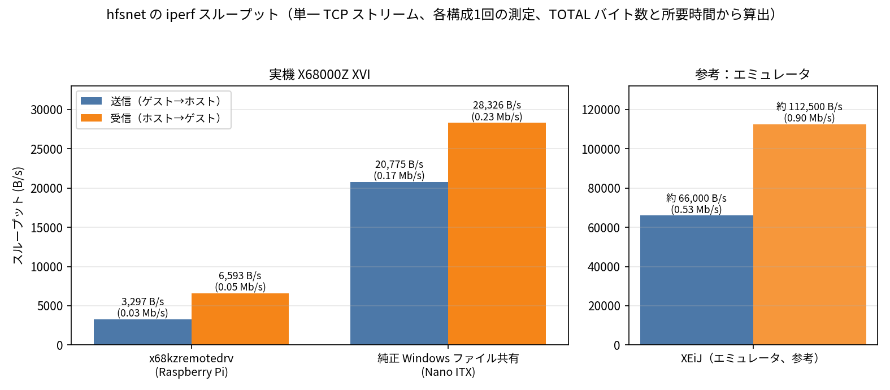
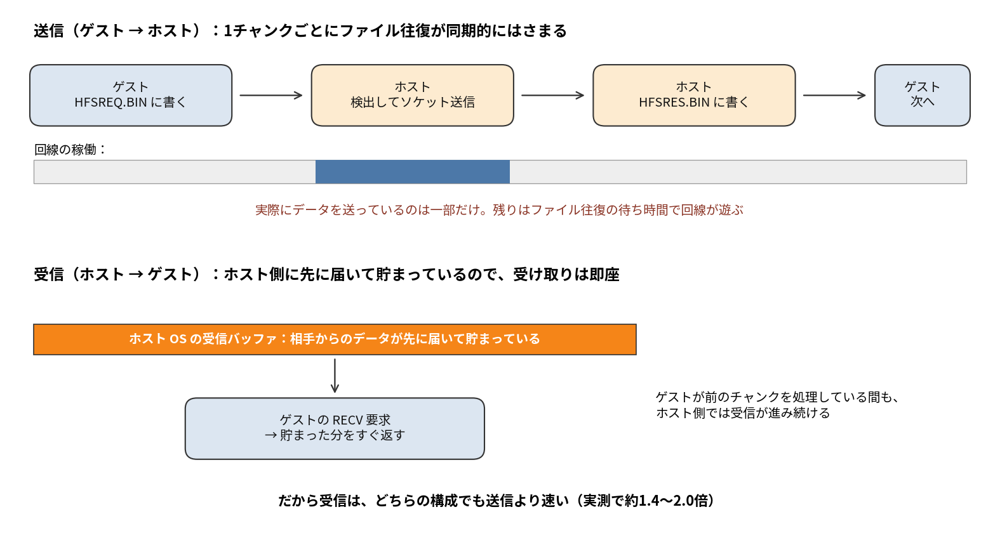

# hfsnet 実機 iperf スループット測定報告

[English](IPERF-REPORT.en.md)

- 測定日：2026-11-19
- 対象：実機 X68000Z XVI "X EMULATER"、hfsnet v0.4.0
- 共有経路は2通り。Raspberry Pi 上で動く x68kzremotedrv（yunkya2 氏）経由と、X68000Z XVI 純正の「Windowsとのファイル共有」（相手は内蔵 Nano ITX の Windows PC）経由

## 測定条件

- iperf による単一 TCP ストリーム、バッファ 64KB、IPv4
- 送信（client）はゲスト側が iperf クライアント、受信（server）はゲスト側が iperf サーバ
- 速度は iperf 出力の TOTAL バイト数と所要時間から算出した（表示上の Mb/s は参考値）
- 各構成とも測定は1回だけ（ばらつきの評価はしていない）

## 結果

| 構成 | 方向 | 転送量（TOTAL） | 時間 | 速度 |
|---|---|---:|---:|---:|
| x68kzremotedrv | 送信（ゲスト→ホスト） | 36,500 B | 11.07 s | 3,297 B/s（0.03 Mb/s） |
| x68kzremotedrv | 受信（ホスト→ゲスト） | 868,352 B | 131.70 s | 6,593 B/s（0.05 Mb/s） |
| 純正 Windows ファイル共有 | 送信（ゲスト→ホスト） | 211,700 B | 10.19 s | 20,775 B/s（0.17 Mb/s） |
| 純正 Windows ファイル共有 | 受信（ホスト→ゲスト） | 1,114,112 B | 39.33 s | 28,326 B/s（0.23 Mb/s） |

参考（エミュレータ XEiJ、2026-11-17 測定）：送信 約66,000 B/s（0.53 Mb/s）、受信 約112,500 B/s（0.90 Mb/s）

## 観察

1. **どちらの方向でも純正 Windows ファイル共有の方が速い**。送信で約6.3倍、受信で約4.3倍。
2. **どちらの構成でも受信が送信より速い**。純正共有で約1.36倍、x68kzremotedrv で約2.0倍。エミュレータ（XEiJ）でも同じ向きの非対称（約1.7倍）が出ており、hfsnet の構造に由来すると考えられる（理由は後述）。
3. **x68kzremotedrv の毎秒転送量はほぼ完全に一定**で、送信は毎秒きっかり 4,380 B/s（= 1,460 × 3）、受信はほぼ毎秒きっかり 8,192 B/s だった。揺らぎではなく、ポーリング周期で決まる決定的な天井と見られる。対して純正共有は毎秒 14k〜34k B/s と変動し、律速は別の場所にある。
4. **実機はエミュレータより遅い**。最速の純正共有・受信（0.23 Mb/s）でも XEiJ の受信（0.90 Mb/s）の約4分の1。
5. 実感に直すと、1 MB の転送は純正共有の受信で約37秒、x68kzremotedrv の送信では約5分かかる。

## 受信が送信より速い理由

hfsnet は、ゲストとホストの間を共有フォルダ内の2つのファイル（HFSREQ.BIN と HFSRES.BIN）でつなぐ、API 単位の受け渡しである。

- **送信**では、ゲストが1チャンク（最大 2,048 バイト）を書くたびに、ホストがそれを検出してソケット送信し、応答ファイルを書き戻すまで、ゲストは次へ進めない。ファイル往復が同期的に効くため、回線は待ち時間の間遊んでいる。
- **受信**では、相手からのデータはホスト OS の受信バッファに先に届いて貯まっている。ゲストの RECV 要求に対して、ホストは貯まった分をすぐ返すことができる。ゲストが前のチャンクを処理している間も、ホスト側では受信が進み続ける。

## 注意点

- 各構成とも n=1 の測定であり、再測定による再現性の確認はしていない。
- 受信（server）側の所要時間は相手の接続時間で決まるため、転送量そのものではなく B/s で比較している。
- x68kzremotedrv の送信では、iperf の毎秒行の合計が TOTAL と一致しなかったため、TOTAL を正とした。

## 考察：2つの共有経路の違いについて

今回の測定では、どちらの方向でも純正の「Windowsとのファイル共有」の方が速かった。ただし2つの経路は、伝送媒体だけでなく、途中の処理やプロトコルも含めて多くの点で異なっており、速度差の原因を単一の要因に帰することはできない。以下は、客観的に確認できる情報から考えられることの整理である。

x68kzremotedrv の経路は、X68000Z の疑似 SCSI 機能を使い、USB 接続された Raspberry Pi Pico W が、無線 LAN 越しに Windows PC の共有フォルダを、あたかも USB メモリ上のディスクイメージのように見せるものである（x68kzremotedrv の README による）。Pico W の USB はフルスピード（12Mbps）が上限で、作者自身も「もっさりする」と記している。一方で、今回の実測値（送信 0.03Mbps）は 12Mbps の460分の1程度であり、USB の公称帯域だけでは実測の低さを説明できない。毎秒の転送量が送信で 4,380 バイト（= 1,460 × 3）、受信で 8,192 バイトとほぼ一定だったことも考え合わせると、帯域そのものよりも、1秒間に完了できる同期的往復の回数が上限になっていた可能性が考えられる。往復の内訳としては、疑似 SCSI のトランザクション、Pico W 側の処理、無線 LAN、ファイル共有プロトコルなどが積み重なっているとみられるが、今回の測定ではその内訳までは切り分けられていない。

純正の「Windowsとのファイル共有」では、X68000Z と内蔵 Nano ITX の Windows PC が内部で直結されており、無線区間は含まれない。毎秒の転送量が 14k〜34k バイトと変動していたことからは、この経路ではリンク側が固定の上限になっているというより、ゲスト側の処理や hfsnet の同期的なファイル交換の方が律速に近い可能性が考えられる。ただし、内部リンク自体の規格や上限を直接測ったわけではないため、「リンクが十分に高速である」とまでは言い切れない。

また、受信が送信より速いという非対称は両経路に共通しており、これは経路の違いではなく、hfsnet 側の構造（前節）に由来する部分が大きいと考えられる。経路の違いが効いているのは、主として速度の絶対値の方だとみられる。

なお、各構成とも測定は1回のみであり、再現性の確認はできていない。経路自体の素の速度（hfsnet を介さないファイルコピー等）と hfsnet のオーバーヘッドを分けて測れば、要因の切り分けがもう少し進むと考えられる。