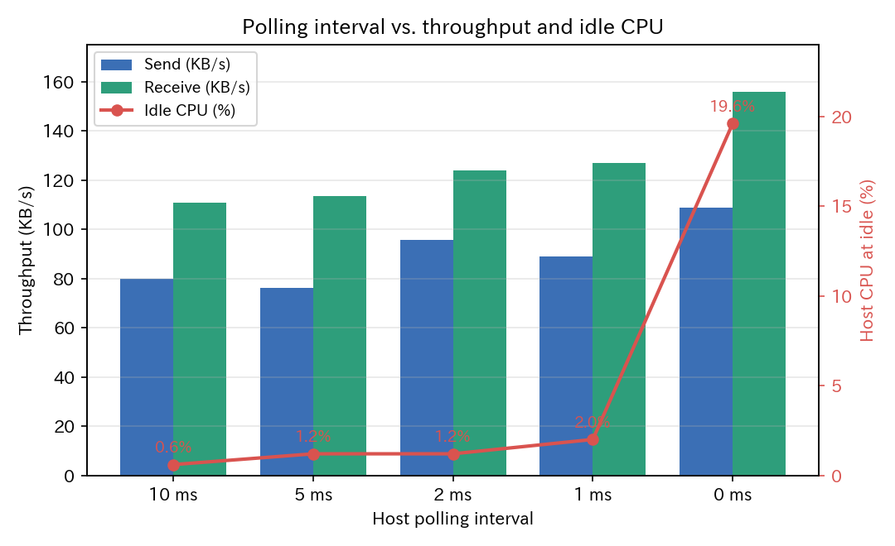

# Polling interval vs. iperf throughput

[English](POLL-BENCH.en.md) | [日本語](POLL-BENCH.md)

Measured on 2026-11-22–23 with the XEiJ rig (:95). The host was the
Python `host/hfsnethost.py` (the watch interval is its second argument,
added for this measurement). The guest ran IPERF.X (a minimal home-made
iperf; 10 seconds and a 64 KB buffer in each direction) against
127.0.0.1:5001 (the host's iperf-host-linux). Two runs per setting.
Raw logs: poll-bench-results-part1.txt (the 10 ms runs, measured before
the outage) and poll-bench-results.txt (the 5/2/1/0 ms runs, re-measured).

## Results (average of 2 runs)

| Interval | Send (KB/s) | Receive (KB/s) | Host CPU at idle | Host CPU during transfer |
|----------|------------|----------------|------------------|--------------------------|
| 10 ms (default) | 79.7 | 110.8 | 0.6% | ~3% |
| 5 ms | 76.1 | 113.4 | 1.2% | ~3% |
| 2 ms | 95.6 | 123.9 | 1.2% | ~4% |
| 1 ms | 89.1 | 127.0 | 2.0% | ~5% |
| 0 ms (no wait) | 108.7 | 155.7 | 19.6% | ~27% |

- CPU is the host process's utime+stime, expressed as a fraction of
  one core.
- Receive throughput is the effective rate until the host-side client
  has sent everything (limited by how fast the guest consumes).
- For reference: the first 5 ms send run, measured in an earlier
  session before the outage, was 90.1 KB/s. Run-to-run variation
  between sessions is about ±10%.

## Reading

- Shorter intervals are reliably faster: 10 ms → 0 ms gives +36% send
  and +40% receive.
- 2 ms captures most of the gain (send +20%, receive +12%) at only
  1.2% idle CPU. 1 ms is about the same as 2 ms (within noise).
- 0 ms is fastest but keeps burning about 20% of one core even at
  idle — not a good trade for a resident companion app.
- Conclusion: the option is well worth having. Keep the default at
  10 ms; 1–2 ms is the sweet spot for users who want more speed.

## Notes

- Measured on XEiJ (an emulator). Expect the same trend but different
  absolute numbers on real hardware or other environments.
- The VM write outage (EPERM) recurred during the first attempt and
  ruined the non-10 ms runs, so the 5 ms and shorter settings were
  re-measured after a runtime restart. The outage investigation
  itself is outside the scope of this memo.
