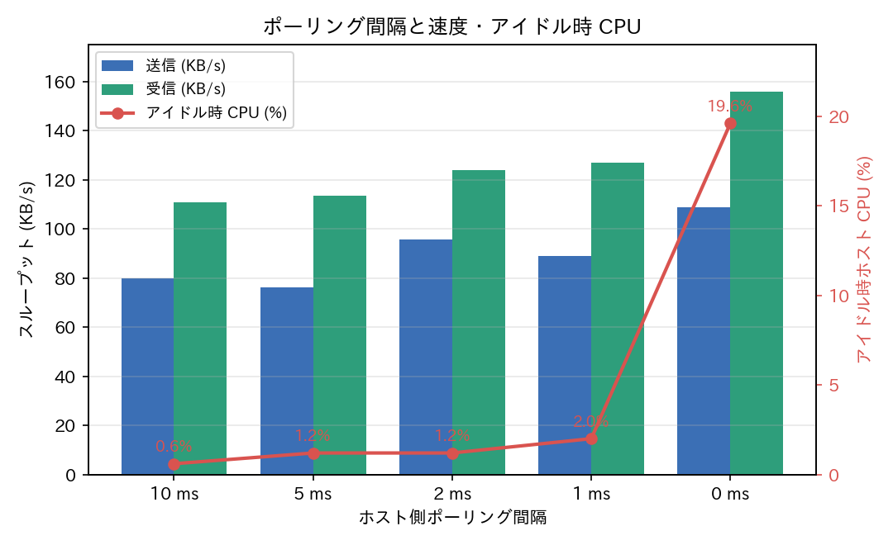

# ポーリング間隔と iperf スループットの測定

[English](POLL-BENCH.en.md)

2026-11-22〜23、XEiJ リグ（:95）で測定。ホストは Python 版
`host/hfsnethost.py`（第2引数で監視間隔を指定、今回の測定用に追加）。
ゲストは IPERF.X（自作の最小 iperf、送受信とも 10 秒・64KB バッファ）、
宛先は 127.0.0.1:5001（ホストの iperf-host-linux と対向）。
各条件 2 回ずつ。生ログは poll-bench-results-part1.txt（10 ミリ秒分、
障害前の測定）と poll-bench-results.txt（5/2/1/0 ミリ秒分、再測定）。

## 結果（2 回の平均）

| 間隔 | 送信 (KB/s) | 受信 (KB/s) | アイドル時ホスト CPU | 転送時ホスト CPU |
|------|------------|------------|--------------------|----------------|
| 10 ms（既定） | 79.7 | 110.8 | 0.6% | 約3% |
| 5 ms | 76.1 | 113.4 | 1.2% | 約3% |
| 2 ms | 95.6 | 123.9 | 1.2% | 約4% |
| 1 ms | 89.1 | 127.0 | 2.0% | 約5% |
| 0 ms（待ちなし） | 108.7 | 155.7 | 19.6% | 約27% |

- CPU はホストプロセスの utime+stime を 1 コア比に換算したもの。
- 受信のスループットは、ホスト側クライアントが全量を送り終えるまでの
  実効値（ゲストの消費速度に律速される）。
- 参考: 障害前の別セッションで測った 5 ms の送信 1 回目は 90.1 KB/s。
  セッション間のばらつきが ±10% 程度ある。

## 読み取り

- 間隔を短くすると確実に速くなる。10 ms → 0 ms で送信 +36%、
  受信 +40%。
- 2 ms で大半の改善が得られ（送信 +20%、受信 +12%）、アイドル時
  CPU は 1.2% と小さい。1 ms は 2 ms とほぼ同等（誤差範囲）。
- 0 ms は最速だが、アイドル時でも 1 コアの約 20% を消費し続ける。
  常駐アプリとしては割に合わない。
- 結論: オプション化には十分な効果がある。既定は 10 ms のまま据え置き、
  速くしたい人は 1〜2 ms を選ぶのが落としどころ。

## 注意

- XEiJ（エミュレータ）での測定。実機や他環境では傾向は同じでも
  絶対値は変わりうる。
- 測定中に VM の書き込み障害（EPERM）が再発し、10 ms 以外の初回測定が
  崩れたため、5 ms 以降はランタイム再起動後に取り直した。
  障害の切り分け記録は本メモの範囲外。
