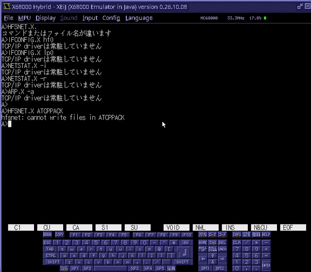

# hfsnet: management tool support in detail

[English](MANAGEMENT.en.md) | [日本語](MANAGEMENT.md)

This page covers the four TCPPACK management tools
(ifconfig.x / netstat.x / inetdconf.x / arp.x): what each
option originally means, and how far it works with hfsnet.

The marks mean:

- ○: works
- △: runs, but the effect is limited to display and to the
  settings ledger (stored values), or it is partly unverified
- ×: not supported

As a premise: in hfsnet the TCP/IP stack lives in the host
application, so guest-side settings do not affect the actual
traffic. See "About guest-side settings" in the README for
details. Most of the △ marks below exist for this reason.

Verification status (as of 2026-11-22): the displays are
verified on XEiJ, XM6 TypeG, and WebX68k. Real hardware is
unverified.

## Video

All four management tools run end to end (recorded on XEiJ).

The sequence is: installing the driver (the host IP address
is shown), ifconfig.x for hf0 and lp0, netstat.x -i
(interface statistics) and -r (routing table), arp.x -a,
the inetdconf.x display, setting +router and +dns and
reading them back, netstat.x -r again to check the gateway
flag (UG), and finally ifconfig.x down and up. Click the
image for the MP4 version (real speed, about 2 minutes);
the GIF plays at double speed.

## ifconfig.x (interface settings and display)

Syntax: `ifconfig <name> [address] [netmask <value>]
[broadcast <value>] [up|down]`

Interface names are lowercase (hf0 / lp0); uppercase gives
"no such interface". Started with no name and no arguments,
it exits silently. This version of ifconfig has no list-all
switch (like -a) and no switches for mtu or similar fields.

- **Display only (name alone): ○**
  Shows the flags, the IP address, the netmask, and the
  broadcast address
- **Giving an address: △**
  The value is kept in the ledger and reflected in the
  display. The source address of your traffic stays the
  host's and does not change. The address may also be a
  host name (resolution is done on the host side). Giving
  an address twice warns, and the last one wins
- **netmask <value>: △**
  Kept in the ledger. When omitted, the classful default
  applies (class A /8, B /16, C /24)
- **broadcast <value>: △**
  Kept in the ledger. When omitted, it becomes
  "address | ~netmask"
- **up: △**
  Sets the UP flag in the ledger; the display becomes
  something like `flags=15<UP,NOARP,BROADCAST>`. The
  RUNNING flag is not set (that is how ifconfig itself
  behaves; in a real stack the driver sets RUNNING)
- **down: ○**
  Brings the interface down; the display becomes
  `flags=14<DOWN,NOARP,BROADCAST>`. This is a ledger
  state change only: hfsnet traffic itself does not stop

## netstat.x (network status display)

The options are the eight letters `-f -I -i -n -p -r -s -w`.

- **No arguments / -f inet (connection list): ○**
  Lists the current connections with protocol, send and
  receive queues, local and foreign addresses, and the
  TCP state. A clean, silent exit with no connections is
  verified. The list display with live connections is
  unverified
- **-f local: (original behavior)**
  For Unix-domain sockets (communication inside one
  machine). TCPPACK has no such mechanism, and the
  original implementation only prints
  "Sorry, not supported."
- **-i (interface list): ○**
  For each interface it shows the MTU, the network, the
  address, received packets (Ipkts), receive errors
  (Ierrs), sent packets (Opkts), send errors (Oerrs),
  and collisions (Coll). Ipkts and Opkts are real
  numbers: the guest counts successful socket sends and
  receives. Ierrs / Oerrs / Coll are always 0 (errors
  and collisions happen on the host side or the physical
  layer and cannot be observed from the guest). Address
  name conversion does not work; output is always numeric
- **-I <name>: △**
  Restricts the -i display to one interface. Same display
  path, but not explicitly verified
- **-n (no name conversion): △**
  hfsnet always displays numbers anyway, so the result
  is the same with or without it
- **-r (routing table): ○**
  Shows the destination, gateway, flags (U = up,
  G = via gateway, H = host route), Use (packets sent
  via that route), and the outgoing interface. Use is
  always 0 (lookups do not increment it). The G flag
  appears once a default router has been set with
  inetdconf.x, because the ledgers are shared
- **-s (protocol statistics): (not implemented in the
  original TCPPACK either)**
  Intended to show per-protocol statistics (IP / ICMP /
  UDP / TCP), but in this version of netstat the flag is
  set and never read, so nothing is displayed. Making
  the driver's statistics (the MIB) real counters would
  not change this netstat's behavior
- **-w <seconds> (continuous monitoring): △**
  Repeatedly shows the counter increments and totals at
  the given interval. It only reads counters, so it
  should work mechanically, but it is unverified. The
  default monitored interface is the first in the list,
  which in hfsnet is lp0 (loopback), so use
  `-I hf0 -w 1` to watch hf0
- **-p: (not implemented in the original TCPPACK either)**
  A reserved slot marked TODO in the source; does nothing

## inetdconf.x (driver settings)

Options come in "+ to set, - to clear" pairs, and several
can be given in one invocation (for example
`INETDCONF.X +router 192.168.1.1 +dns 192.168.1.1 -rip`).

- **No arguments (show current settings): ○**
  Shows four items: the default router, the RIP state,
  the DNS server list, and the domain name. Addresses
  are never converted to names; always numeric
- **+router <address>: ○**
  Sets the default router (where packets for unknown
  destinations are handed to). The address may be a host
  name. The tool first checks that a route to that router
  exists and errors with "No route for ..." otherwise.
  Setting and reading the value back are verified
- **-router: △**
  Clears the default router. The ledger removal is
  implemented, but an explicit read-back check has not
  been done
- **+dns <address>: ○**
  Registers a DNS server (the place name resolution
  asks). Several can be registered at once by listing
  them after the option. The ledger holds up to 4.
  Setting and reading back are verified. Giving a host
  name instead of an address is unverified
- **-dns <address>: △**
  Removes a registered DNS server. Implemented, but an
  explicit read-back check has not been done
- **+domain <name> / -domain: △**
  Sets and clears this machine's domain name. Up to 63
  characters; longer names are rejected by the tool
  itself. Set, store, and display are implemented, but
  displaying an actual value has not been verified
- **+rip / -rip: △**
  Turns RIP (Routing Information Protocol, the scheme
  by which nearby routers exchange route information)
  on and off. The ledger flag is implemented, and the
  "Off" display is verified; the "On" path is unverified.
  Note that inetd.x runs RIP by default, while hfsnet
  starts at Off because it exchanges no routes at all
- **Unknown options: (application-side behavior)**
  Prints the usage text and an "Illeagal option" error
  (spelling as in the original). The usage text itself
  has an original bug and says "+route", but what
  actually works is "+router"

## arp.x (ARP table display and control)

ARP (Address Resolution Protocol) maps IP addresses to
hardware addresses (MAC addresses). Note that this tool
processes only the first option given.

- **No arguments: (application-side behavior)**
  Prints the usage text (4 lines)
- **arp <host name or IP address> (single entry): △**
  Shows one entry as "name (IP address) at hardware
  address". With hfsnet, name resolution proceeds
  correctly and the result is always "-- no entry"
- **-a (list all): ○**
  Lists every entry in the table. With hfsnet the table
  is empty, so it exits silently and successfully. The
  driver hands the table over in a fixed form, an array
  of 17 bucket head pointers, and that entry point is
  implemented (returning NULL makes -a crash)
- **-d <host> (delete): △**
  Deletes an entry. With hfsnet nothing happens, which
  is the correct outcome because there is nothing to
  delete
- **-s <host> <hardware address> (manual entry): △**
  Registers a mapping by hand; with hfsnet it is not
  kept. After passing the direct-route check (a mapping
  cannot be registered for a host reached via a
  gateway), it stops with "Unable to convert hardware
  address, because iface can't handle it.", because the
  interface has no hardware-address parser
- **-f <file>: (not implemented in the original
  TCPPACK either)**
  The option is accepted and silently ignored

The essential limitation is that ARP only exists inside
a LAN. With inetd.x, the Ethernet driver really sends
and receives ARP and the table grows (a peer stays for
10 minutes after communicating). With hfsnet, the host
stack carries the traffic and the host OS owns the ARP
table. The guest cannot see it, and a table built on
the guest side would never be used for communication.

## Limitations summary

- Guest-side settings (address, netmask, default router,
  DNS servers, domain name, RIP on/off) are kept in the
  ledger and reflected in the displays only; they do not
  affect actual traffic. Real communication is decided by
  the host-side stack and the host OS settings
- The ARP table is not visible from the guest. The real
  table belongs to the host OS (arp.x -a works normally
  against an empty table)
- The MIB (Management Information Base, the SNMP (Simple
  Network Management Protocol) statistics database) is an
  empty dummy. Note that the netstat.x statistics display
  (-s option) is unimplemented in the original TCPPACK too
- No reverse name lookups are done, so displays in
  netstat.x and friends always show numeric addresses
- RIP initially displays as Off (inetd.x defaults to On)
- Real hardware is unverified (verified on XEiJ, XM6
  TypeG, and WebX68k)
